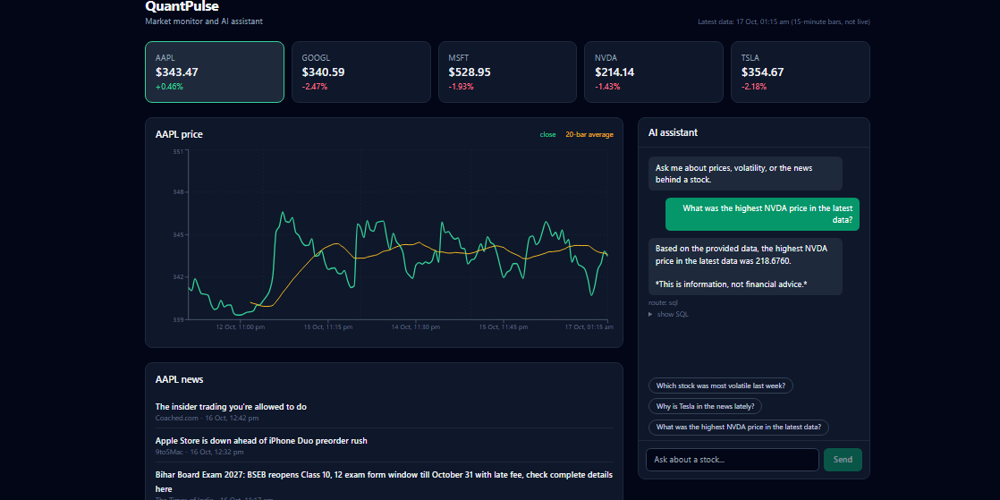
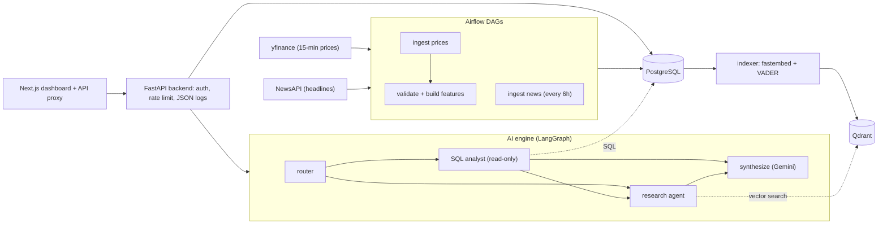

# QuantPulse

[](https://github.com/sdiveshh/quantpulse/actions/workflows/ci.yml)

A market monitor and AI assistant. It ingests 15-minute stock prices and news headlines on a schedule, stores them in PostgreSQL and Qdrant, and answers questions through a LangGraph agent behind a FastAPI backend and a Next.js dashboard.



## Features

- **Scheduled ingestion:** Airflow pulls 15-minute prices (yfinance) for AAPL, MSFT, GOOGL, TSLA and NVDA every 15 minutes, and news (NewsAPI) every 6 hours to stay inside the free API limit.
- **Data quality checks** run before transforms (null or non-positive close, high below low, negative volume). A failed check stops the run.
- **Derived features:** percent return, 20-bar moving average and 20-bar volatility, written to `stock_features`.
- **Semantic news search:** headlines are embedded locally with fastembed (BAAI/bge-small-en-v1.5, 384 dimensions), scored with VADER sentiment, and stored in Qdrant.
- **LangGraph agent:** a router sends each question to a SQL analyst, a research agent, or both. A final step writes the answer with Gemini.
- **Guarded text-to-SQL:** one SELECT only, allowlisted tables, read-only session, 5 second timeout, and up to 3 self-correcting retries.
- **FastAPI backend:** asyncpg connection pool, Pydantic v2 validation, API-key auth (constant-time compare), rate limiting, and structured JSON logs with request IDs.
- **Dashboard:** Next.js (App Router), Tailwind and Recharts. A server-side proxy adds the API key, so it never reaches the browser.
- **Tests and CI:** pytest suites for the SQL guard and API, and GitHub Actions that run the tests and build the frontend.

## Architecture



## Quick start

Requirements: Docker Desktop, and free API keys for [NewsAPI](https://newsapi.org) and [Google AI Studio](https://aistudio.google.com).

1. Clone the repo and copy `.env.example` to `.env`.
2. Fill in `NEWS_API_KEY`, `GOOGLE_API_KEY`, a `POSTGRES_PASSWORD` (letters and numbers only), and set `API_KEY` to a long random string.
3. Start the stack:

```
docker compose up -d --build
```

4. Load data (Airflow is behind a profile because it needs extra memory):

```
docker compose --profile airflow up -d
docker compose exec airflow-webserver airflow dags unpause quantpulse_market_pipeline
docker compose exec airflow-webserver airflow dags unpause quantpulse_news_pipeline
docker compose exec airflow-webserver airflow dags trigger quantpulse_market_pipeline
docker compose exec airflow-webserver airflow dags trigger quantpulse_news_pipeline
docker compose run --rm ai-engine python src/embeddings/vector_indexer.py
```

5. Open http://localhost:3000 (Airflow UI: http://localhost:8080, default login `admin` / `admin`, change it before exposing it anywhere).

News is embedded on demand by running the indexer command again after new headlines arrive.

## Tests and CI

```
python -m pytest ai_engine/tests
python -m pytest app_server/backend/tests
```

GitHub Actions runs both suites and a production build of the frontend on every push.

## Security notes

- The API key lives only in `.env` and on the server side. The dashboard calls a Next.js proxy, which adds the key.
- Database, vector store and AI service ports are bound to localhost.
- The rate limiter is in-memory and per process. Use a shared store such as Redis if you run several instances. Set `TRUST_PROXY=1` only behind a proxy you control.
- Containers run as non-root users, and secrets are passed as environment variables, never baked into images.

## Limitations

- Prices come from yfinance, which is unofficial and delayed. This is a learning project, not trading software, and it is not financial advice.
- The free Gemini tier has low rate limits, so heavy use can return errors.
- Only five tickers are tracked.
- The news embedding step is run manually rather than scheduled.

## Project structure

```
data_pipeline/    Airflow DAGs, ingestion and transforms
ai_engine/        LangGraph agents, embeddings, AI service
app_server/
  backend/        FastAPI API (auth, rate limiting, logging)
  frontend/       Next.js dashboard and API proxy
db/               SQL schema and migrations (run on first start)
```